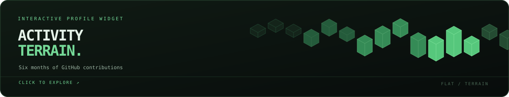

I'm a B.Tech Computer Science student at Vardhaman College of Engineering, Hyderabad. Alongside coursework, I build working products that blend product thinking, hands-on development, and AI-assisted prototyping.
> status     B.Tech CSE · VCEH · 2025 – present
> building   DoomGuard, MedicPal
> exploring  Google AI Studio, Gemini
> method     strategy first, code second

  
<b>Certifications</b>

   

Certification	Issuer	Date
Develop AI-Powered Prototypes in Google AI Studio	Google	Aug 2026
Learn Git and GitHub	Scrimba	Aug 2026
Three more	See LinkedIn	

  
<b>Independent research</b>

   

  Outer Space as a Refrigeration Medium for Quantum Computing Infrastructure · Apr 2026

  An independent hypothesis exploring permanently shadowed lunar craters and deep-space environments as passive cooling settings for quantum computing infrastructure.

  <a href="https://doesntmattericare.github.io/"><b>↗ OPEN INTERACTIVE ACTIVITY TERRAIN</b></a>

