<picture><source media="(prefers-color-scheme: dark)" srcset="assets/title-dark.svg"></picture>

<picture><source media="(prefers-color-scheme: dark)" srcset="assets/marquee-dark.svg"></picture>

<a href="https://rehan07portfolio.netlify.app"><b>Portfolio</b></a>&nbsp;&nbsp;/&nbsp;&nbsp;<a href="https://linkedin.com/in/mohammed-rehan-developer-"><b>LinkedIn</b></a>&nbsp;&nbsp;/&nbsp;&nbsp;<a href="mailto:rehanstudy4@gmail.com"><b>Email</b></a>

<picture><source media="(prefers-color-scheme: dark)" srcset="assets/scene-about-dark.svg"></picture>

<picture><source media="(prefers-color-scheme: dark)" srcset="assets/h-work-dark.svg"></picture>

<a href="https://github.com/DoesntMatterICare/AntiDoomScroller"><picture><source media="(prefers-color-scheme: dark)" srcset="assets/sc-doomguard-dark.svg"></picture></a><a href="https://github.com/DoesntMatterICare/Static"><picture><source media="(prefers-color-scheme: dark)" srcset="assets/sc-static-dark.svg"></picture></a>

<a href="https://github.com/DoesntMatterICare/ScribFight"><picture><source media="(prefers-color-scheme: dark)" srcset="assets/sc-drawfight-dark.svg"></picture></a><a href="https://github.com/DoesntMatterICare/MedicPal"><picture><source media="(prefers-color-scheme: dark)" srcset="assets/sc-medicpal-dark.svg"></picture></a>

<a href="https://github.com/DoesntMatterICare/workshop"><picture><source media="(prefers-color-scheme: dark)" srcset="assets/sc-workshop-dark.svg"></picture></a><a href="https://github.com/DoesntMatterICare/student-developer-club-social-vce"><picture><source media="(prefers-color-scheme: dark)" srcset="assets/sc-sdc-dark.svg"></picture></a>

<picture><source media="(prefers-color-scheme: dark)" srcset="assets/h-cast-dark.svg"></picture>

<picture><source media="(prefers-color-scheme: dark)" srcset="assets/cast-dark.svg"></picture>

<picture><source media="(prefers-color-scheme: dark)" srcset="assets/h-laurels-dark.svg"></picture>

<picture><source media="(prefers-color-scheme: dark)" srcset="assets/laurels-dark.svg"></picture>

In development: <a href="https://github.com/DoesntMatterICare/QuantumSpaceCooling"><i>Outer Space as a Refrigeration Medium for Quantum Computing</i></a>, an independent research paper.

<picture><source media="(prefers-color-scheme: dark)" srcset="assets/h-dailies-dark.svg"></picture>

Last 66 days of commits, re-rendered daily by a GitHub Action.

<a href="https://doesntmattericare.github.io/"><picture><source media="(prefers-color-scheme: dark)" srcset="assets/dailies-dark.svg"></picture></a>

<a href="https://doesntmattericare.github.io/"><b>▶ Watch the full reel: interactive contribution terrain</b></a>

 

<a href="mailto:rehanstudy4@gmail.com"><picture><source media="(prefers-color-scheme: dark)" srcset="assets/ending-dark.svg"></picture></a>
