


 


I'm a **B.Tech Computer Science** student at **Vardhaman College of Engineering, Hyderabad**. Alongside coursework, I build working products that blend product thinking, hands-on development, and AI-assisted prototyping.

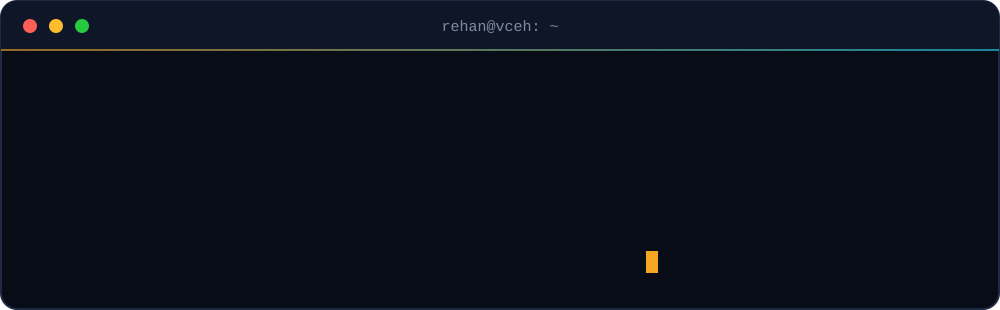


<a href="https://github.com/DoesntMatterICare/AntiDoomScroller">
  
</a>

<a href="https://github.com/DoesntMatterICare/MedicPal">
  
</a>

<a href="https://github.com/DoesntMatterICare/workshop">
  
</a>




  
<b>Certifications</b>

   

  | Certification | Issuer | Date |
  |---|---|---|
  | Develop AI-Powered Prototypes in Google AI Studio | Google | Aug 2026 |
  | Learn Git and GitHub | Scrimba | Aug 2026 |
  | Three more | [See LinkedIn](https://linkedin.com/in/mohammed-rehan-developer-) | |

  
<b>Independent research</b>

   

  **[Outer Space as a Refrigeration Medium for Quantum Computing Infrastructure](https://github.com/DoesntMatterICare/QuantumSpaceCooling)** · Apr 2026

  An independent hypothesis exploring permanently shadowed lunar craters and deep-space environments as passive cooling settings for quantum computing infrastructure.

<picture>
  <source media="(prefers-color-scheme: dark)" srcset="https://github-readme-stats.vercel.app/api?username=DoesntMatterICare&show_icons=true&theme=transparent&title_color=F5A524&icon_color=22D3EE&text_color=c9d1d9&hide_border=true" />
  
</picture>
<picture>
  <source media="(prefers-color-scheme: dark)" srcset="https://github-readme-stats.vercel.app/api/top-langs/?username=DoesntMatterICare&layout=compact&theme=transparent&title_color=F5A524&text_color=c9d1d9&hide_border=true" />
  
</picture>

 

<a href="mailto:rehanstudy4@gmail.com">
  
</a>
